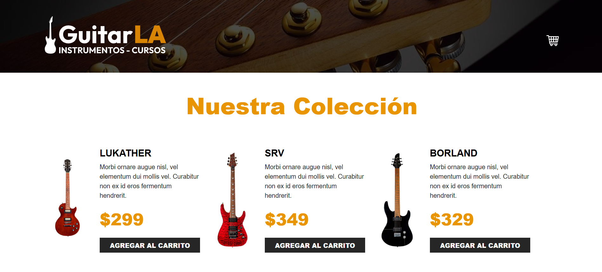
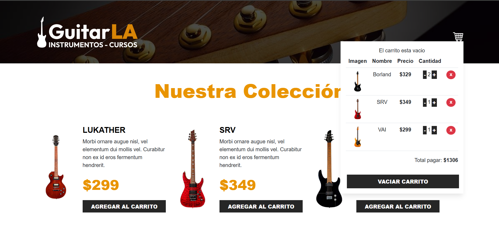

# Documentación Técnica: GuitarLA - Tienda Virtual de Guitarras

---

## Visión General del Proyecto
**GuitarLA** es una aplicación web interactiva de comercio electrónico enfocada en la exhibición y venta de un catálogo de guitarras. Su propósito principal es resolver la gestión en tiempo real de un carrito de compras interactivo, permitiendo a los usuarios consultar productos, agregar ítems, incrementar o reducir unidades, eliminar artículos específicos, vaciar el carrito por completo y calcular el costo total a pagar de forma dinámica sin recargar la página.

### Capturas de pantalla o GIF demostrativo de la interfaz en funcionamiento

### Enlace al despliegue en producción 
* **Demo Activa:** Entorno local en `http://localhost:5173`

---

## Ficha técnica

### Lenguajes, versiones y dependencias clave utilizadas
* **JavaScript ES6+ / TypeScript:** Desarrollado sobre TypeScript utilizando un nivel de tipado estático estricto mediante interfaces y declaraciones de tipos personalizadas (`types.d.ts`), garantizando autocompletado y validación de tipos en componentes y datos (`.tsx` y `.ts`).
* **React:** Versión 18+ (Librería principal orientada a la arquitectura de componentes declarativos).
* **Vite:** Entorno de desarrollo rápido y empaquetador de módulos (Bundler).
* **Estilos / Layout:** Integración de grid layout y clases utilitarias de Bootstrap / CSS (`container-xl`, `row`, `col-md-6`, `flex`, `gap-4`, `table`, etc.).
* **npm:** Gestor de paquetes del proyecto.
* **Dependencias Clave:**
  * `@types/react`: Definiciones de tipos para React.
  * `@types/react-dom`: Definiciones de tipos para React DOM.
  * `typescript`: Compilador y motor de tipos estáticos.

---

## Arquitectura React & Hooks

#### Hooks Estándar

* **useState:**
  * **Motivo e implementación:** Administra estados locales como la lista del carrito de compras, el catálogo de productos y banderas de la interfaz de usuario.
* **useEffect:**
  * **Motivo e implementación:** Maneja los efectos secundarios y el ciclo de vida del componente, como la persistencia en `localStorage` y la sincronización con fuentes de datos externas o listeners.
* **useRef:**
  * **Motivo e implementación:** Se utiliza para mantener referencias directas a elementos del DOM sin provocar re-renderizados innecesarios en la interfaz.
* **useMemo:**
  * **Motivo e implementación:** Optimiza el rendimiento al memorizar y almacenar en caché cálculos pesados derivados, como los totales del carrito e indicadores de estado en `Header.tsx`.
* **useCallback:**
  * **Motivo e implementación:** Memoriza la definición de funciones controladoras pasadas como props para evitar la recreación de funciones en cada renderizado.
* **useContext / useReducer:**
  * **Motivo e implementación:** Permiten la gestión de estado global y flujos complejos. En esta aplicación, el estado se simplifica y desacopla mediante el Custom Hook `useCart`.

#### Custom Hooks (Hooks Personalizados)

* **`useCart`:**
  * **Motivo de implementación:** Desacopla y encapsula toda la lógica de negocio del carrito de compras fuera de la capa de presentación (componentes UI), facilitando la reutilización, legibilidad y mantenimiento del código.
  * **Lógica encapsulada:** Administra la adición de productos, modificación de cantidades, eliminación de ítems, cálculo de montos totales, limpieza completa del carrito y verificación del estado vacío.
  * **Ubicación y valores/métodos expuestos:** Se consume en `App.tsx` y expone:
    * `cart`: Lista de elementos guardados en el carrito con sus cantidades.
    * `data`: Colección local de guitarras de la base de datos/catálogo.
    * `handlerClick(guitar)`: Agrega una guitarra al carrito o incrementa sus unidades si ya existe.
    * `increaseQuantity(id)`: Incrementar la cantidad de un producto.
    * `decreaseQuantity(id)`: Decrementar la cantidad de un producto.
    * `removeFromCart(id)`: Eliminar un artículo específico por su ID.
    * `emptyCart()`: Vacía todos los elementos del carrito.
    * `calculateTotal()`: Calcula el total global acumulado.
    * `isEmpty`: Estado derivado para validar si el carrito carece de artículos.

---

## Patrones y Buenas Prácticas

### Manejo de componentes
Se aplica una separación clara entre componentes contenedores/inteligentes (Smart Components) y componentes presentacionales (Dumb Components):
* **Componentes Inteligentes:** `App.tsx` actúa como contenedor principal, gestionando la invocación de `useCart` y la distribución de controladores de eventos hacia las vistas.
* **Componentes Presentacionales:** 
  * `Header.tsx`: Renderiza la navegación, el logotipo y la tabla desplegable del carrito interactivo consumiendo props.
  * `Guitar.tsx`: Renderiza la tarjeta de producto individual e invoca `handlerClick` para agregar ítems.

### Tipado
El paso de parámetros e interfaces de datos está fuertemente tipado mediante TypeScript (`CartProps`, `GuitarProps`), evitando errores en tiempo de ejecución y asegurando que las props cumplan la estructura esperada.

### Modularización
El proyecto se organiza dividiendo responsabilidades en archivos independientes para componentes (`Header.tsx`, `Guitar.tsx`), hooks personalizados (`useCart.ts`) y tipos compartidos, manteniendo un código limpio y escalable.

### Gestión de estado e inmutabilidad
Se implementa una arquitectura con elevación de estado (*State Hoisting*) centralizada en `useCart`, permitiendo un flujo de datos unidireccional (*Unidirectional Data Flow*) hacia los componentes. Las mutaciones de datos evitan modificar directamente el estado anterior, utilizando métodos declarativos inmutables (`.map`, `.filter`, operador de propagación).

### Persistencia de datos
Se utiliza `localStorage` para almacenar de forma persistente el contenido del carrito, garantizando que la selección del usuario no se pierda al recargar o cerrar la pestaña del navegador.

---

## Puesta en marcha

### Instrucciones paso a paso para clonar, instalar variables/dependencias y ejecutar el entorno local

#### Prerrequisitos
* Node.js (v18.0.0 o superior)
* npm (v9.0.0 o superior)

#### Pasos de instalación y ejecución

1. **Clonar el repositorio:**
   git clone [https://github.com/Jr-caballero18/GuitarsLA-Ts.git]
   
2. **Ejecutar el siguiente comando en la terminal estando en la direccion del proyecto:**
   npm run dev
