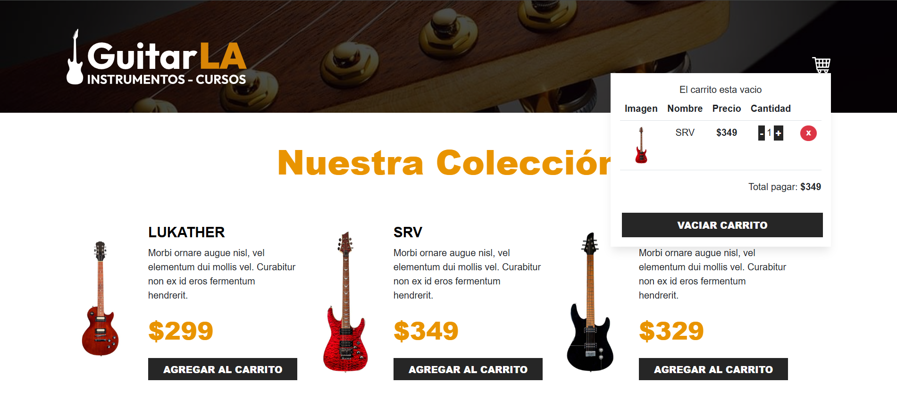
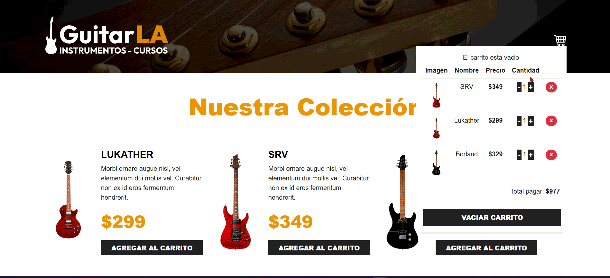
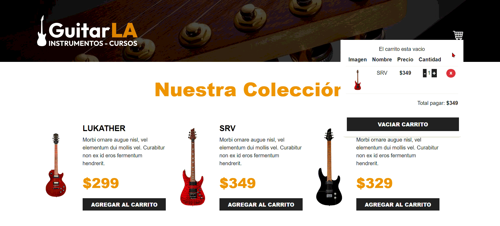
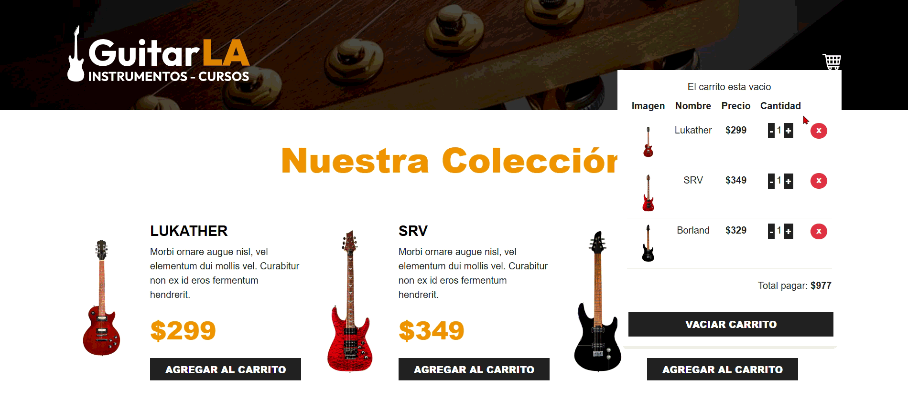

# GuitarsLA-Ts

Aplicación web de una tienda de guitarras desarrollada con React y TypeScript. Permite visualizar una colección de instrumentos y administrar un carrito de compras mediante componentes reutilizables y un hook personalizado.

## Índice

- [1. Visión General del Proyecto](#1-visión-general-del-proyecto)
- [2. Ficha Técnica y Tecnologías](#2-ficha-técnica-y-tecnologías)
- [3. Arquitectura e Implementación en React](#3-arquitectura-e-implementación-en-react)
- [4. Patrones y Buenas Prácticas](#4-patrones-y-buenas-prácticas)
- [5. Manejo de Estado y Persistencia](#5-manejo-de-estado-y-persistencia)
- [6. Puesta en Marcha](#6-puesta-en-marcha)

---

## 1. Visión General del Proyecto

### 1.1 Nombre y propósito de la aplicación

**Nombre:** GuitarsLA-Ts.

GuitarsLA-Ts es una aplicación web interactiva que simula una tienda virtual de instrumentos musicales. Su propósito principal es permitir a los usuarios consultar un catálogo de guitarras, agregar instrumentos a un carrito de compras interactivo, modificar las cantidades de cada producto, eliminar elementos individualmente, vaciar el carrito completo y calcular el importe total a pagar en tiempo real.

La aplicación fue desarrollada utilizando React y TypeScript, estructurando el sistema en componentes reutilizables y desacoplando la lógica de negocio en un hook personalizado (*Custom Hook*).

### 1.2 Problema que resuelve

La aplicación resuelve la necesidad de administrar las interacciones de un carrito de compras en una tienda digital sin necesidad de recargar la página ni realizar peticiones innecesarias al servidor. Facilita la exploración visual de productos, el cálculo dinámico de subtotales y la persistencia de la selección del usuario durante su sesión de navegación.

### 1.3 Funcionalidades principales

- Visualización dinámica del catálogo de guitarras.
- Presentación detallada del nombre, imagen, descripción y precio de cada instrumento[cite: 3].
- Agregado de productos al carrito de compras desde el catálogo[cite: 1, 3].
- Incrementar y decrementar unidades de un producto dentro del carrito[cite: 1, 4].
- Eliminación individual de artículos del carrito mediante su identificador[cite: 1, 4].
- Opción para vaciar completamente el carrito de compras[cite: 1, 4].
- Cálculo automatizado e inmutable del monto total a pagar[cite: 1].
- Evaluación de estado derivado para detectar si el carrito se encuentra vacío (`isEmpty`)[cite: 1, 4].
- Conservación automática de los productos seleccionados mediante `localStorage`.

### 1.4 Capturas de pantalla de la aplicación

#### Página principal y colección de guitarras


#### Carrito de compras


#### Agregar guitarra



#### Aumentar y disminuir cantidad


#### Eliminar guitarra


#### Vaciar carrito



### 1.5 Repositorio y despliegue

- **Repositorio de GitHub:** [https://github.com/Jr-caballero18/GuitarsLA-Ts.git](https://github.com/Jr-caballero18/GuitarsLA-Ts.git)
- **Despliegue en producción:** La aplicación se ejecuta en entorno local en `http://localhost:5173`.

---

## 2. Ficha Técnica y Tecnologías

### 2.1 Lenguajes de programación

| Tecnología | Uso en el proyecto |
| :--- | :--- |
| **TypeScript** | Proporciona tipado estático estricto para describir las propiedades de componentes, modelos de datos y estructuras de productos (`.tsx` y `.ts`). |
| **JavaScript ES6+** | Base de ejecución de la aplicación React; se utilizan funciones flecha, desestructuración, iteradores y métodos inmutables de arreglos (`map`, `filter`). |
| **TSX** | Sintaxis que permite escribir componentes de React combinando TypeScript con la estructura declarativa de JSX. |
| **CSS** | Define los estilos globales y las reglas de presentación de la aplicación. |

**Nivel de tipado:** Tipado estático mediante TypeScript. Se emplean definiciones explícitas (`types.d.ts`) como `CartProps` y `GuitarProps` para garantizar la integridad de los datos en el flujo de la aplicación.

### 2.2 Framework y librerías de interfaz

| Tecnología | Función |
| :--- | :--- |
| **React 18** | Construcción de la interfaz de usuario mediante componentes funcionales y hooks declarativos. |
| **React DOM** | Encargado del renderizado y montaje de la aplicación en el DOM del navegador. |
| **Bootstrap / Utility CSS** | Maquetación responsiva, grillas (`container-xl`, `row`, `col-md-6`), tablas y estilos para botones. |
| **CSS** | Estilos globales y personalización de la interfaz. |

### 2.3 Entorno de desarrollo y herramientas

| Herramienta | Función |
| :--- | :--- |
| **Vite** | Servidor de desarrollo ultrarrápido y empaquetador de módulos (*bundler*). |
| **npm** | Gestor de paquetes utilizado para instalar y administrar las dependencias del proyecto. |
| **Git** | Sistema de control de versiones distribuido. |
| **GitHub** | Plataforma de alojamiento para el repositorio remoto. |
| **Visual Studio Code** | Editor de código fuente utilizado para el desarrollo. |

### 2.4 Dependencias clave

- `react`: Librería principal para la creación de componentes y gestión de estados/hooks.
- `react-dom`: Módulo para renderizar la aplicación en el entorno web.
- `typescript`: Compilador que añade verificación de tipos en tiempo de desarrollo.
- `@types/react` / `@types/react-dom`: Paquetes con definiciones de tipos para React.
- `vite`: Herramienta de compilación y servidor local.

*Nota:* No se utiliza un cliente HTTP externo ni enrutamiento dinámico; la información de los productos se importa desde una colección estática local.

---

## 3. Arquitectura e Implementación en React

### 3.1 Organización de la aplicación

La aplicación está organizada en componentes presentacionales, un contenedor principal y lógica encapsulada en un Custom Hook:

GuitarsLA-Ts/
├── public/
│   └── img/
│       ├── carrito.png
│       ├── logo.svg
│       └── cart.png
├── src/
│   ├── components/
│   │   ├── Guitar.tsx
│   │   └── Header.tsx
│   ├── hooks/
│   │   └── useCart.ts
│   ├── App.tsx
│   ├── index.css
│   ├── main.tsx
│   └── types.d.ts
├── package.json
├── tsconfig.json
├── vite.config.ts
└── README.md

### 3.2 Hooks nativos de React

#### 3.2.1 useState
- **Función:** Preserva valores de estado que provocan un re-renderizado reactivo de la interfaz cuando cambian.
- **Uso en el proyecto:** Dentro del custom hook `useCart` se utiliza para mantener y actualizar el estado de los artículos en el carrito (`cart`) y la colección de productos (`data`).
- **Justificación:** Permite actualizar dinámicamente la lista de compras ante la adición, incremento o remoción de guitarras.

#### 3.2.2 useEffect
- **Función:** Ejecuta efectos secundarios tras el renderizado según sus dependencias.
- **Uso en el proyecto:** Sincroniza las modificaciones del estado del carrito con el almacenamiento local del navegador (`localStorage`).
- **Justificación:** Garantiza que los productos seleccionados persistan cuando el usuario recarga o regresa a la aplicación.

#### 3.2.3 useMemo
- **Función:** Memoriza el valor de un cálculo derivado entre renderizados mientras sus dependencias no se modifiquen.
- **Uso en el proyecto:** Se utiliza en `Header.tsx` / `useCart` para derivar de forma eficiente la bandera `isEmpty` (`cart.length === 0`), optimizando la evaluación del carrito.
- **Justificación:** Evita recalculados innecesarios y ayuda a controlar la renderización condicional de la vista del carrito.

#### 3.2.4 useRef
- **Función:** Conserva referencias mutables a elementos del DOM o valores entre renderizados sin provocar nuevas renderizaciones.
- **Uso en el proyecto:** No se encuentra implementado en el flujo actual, ya que el comportamiento de la tienda no requiere interacción directa con el DOM.

#### 3.2.5 useCallback
- **Función:** Memoriza definiciones de funciones entre re-renderizados para evitar recreaciones de referencia.
- **Uso en el proyecto:** Las funciones del carrito se entregan directamente desde el custom hook `useCart`.

#### 3.2.6 useContext y useReducer
- **Función:** `useContext` permite compartir estado global sin prop-drilling, y `useReducer` centraliza estados complejos mediante acciones.
- **Uso en el proyecto:** No se implementan. Dado que el árbol de componentes es directo (`App` -> `Header` / `Guitar`), el patrón de Custom Hook + Props satisface los requerimientos de forma limpia.

---

### 3.3 Custom Hooks

#### 3.3.1 useCart
- **Archivo:** `src/hooks/useCart.ts`.
- **Lógica encapsulada:** Centraliza la lógica de negocio del carrito de compras, aislándola de los componentes de la interfaz de usuario.

**Métodos y valores expuestos:**

| Método / Valor | Función |
| :--- | :--- |
| `cart` | Arreglo con la lista actual de ítems y sus cantidades en el carrito. |
| `data` | Arreglo que contiene el catálogo inicial de guitarras. |
| `handlerClick(guitar)` | Agrega una guitarra al carrito o incrementa sus unidades si ya existe. |
| `increaseQuantity(id)` | Incrementa la cantidad de unidades de un producto específico. |
| `decreaseQuantity(id)` | Disminuye las unidades de un producto o lo remueve al llegar a cero. |
| `removeFromCart(id)` | Elimina un producto del carrito según su identificador. |
| `emptyCart()` | Vacía completamente el carrito de compras. |
| `calculateTotal()` | Calcula la suma total multiplicando el precio por la cantidad. |
| `isEmpty` | Booleano derivado que indica si el carrito está vacío. |

- **Reutilización y desacoplamiento:** Consumido en `App.tsx` para coordinar el estado y propagar los handlers a los componentes hijos (`Header` y `Guitar`).

---

### 3.4 Estructura de componentes

#### 3.4.1 App
- **Archivo:** `src/App.tsx`.
- **Responsabilidad:** Funciona como el componente contenedor principal (*Smart Component*). Consume el custom hook `useCart`, itera el catálogo mediante `.map()`, renderiza los componentes `Guitar` y transmite las props y funciones al `Header`.

#### 3.4.2 Guitar
- **Archivo:** `src/components/Guitar.tsx`.
- **Responsabilidad:** Componente presentacional (*Dumb Component*). Recibe la información de un objeto `guitar` y la función `handlerClick` para renderizar la tarjeta del producto e invocar la adición al carrito.

#### 3.4.3 Header
- **Archivo:** `src/components/Header.tsx`.
- **Responsabilidad:** Componente presentacional que muestra la barra superior, el logotipo, el ícono del carrito y la tabla con el detalle de compras, cantidades, totales y botón para vaciar el carrito.

#### 3.4.4 main.tsx
- **Archivo:** `src/main.tsx`.
- **Responsabilidad:** Punto de entrada de la aplicación. Inicializa `createRoot`, envuelve la aplicación en `StrictMode` e inyecta el componente `App` dentro del elemento contenedor del DOM.

---

## 4. Patrones y Buenas Prácticas

### 4.1 Componentes inteligentes y presentacionales
Se mantiene una separación clara entre la lógica y la representación visual:
- **Componente Inteligente:** `App.tsx` (coordina la obtención de datos y distribución de eventos).
- **Componentes Presentacionales:** `Guitar.tsx` y `Header.tsx` (se limitan a renderizar la interfaz y emitir eventos mediante props).

### 4.2 Tipado de Props
Se estructuran contratos estrictos con TypeScript (`CartProps`, `GuitarProps`):
- Garantizan que las props recibidas en cada componente cumplan con las firmas y tipos esperados, evitando errores en tiempo de ejecución.

### 4.3 Modularización
El código está dividido en capas con responsabilidades únicas: componentes UI (`src/components/`), custom hooks (`src/hooks/`) y tipos globales (`src/types.d.ts`).

### 4.4 Inmutabilidad de datos
Las modificaciones en el estado del carrito se realizan generando nuevas referencias de objetos y arreglos utilizando métodos declarativos como `.map()`, `.filter()` y el operador de propagación (`...`), garantizando que React detecte los cambios de forma reactiva.

### 4.5 Separación de responsabilidades
La lógica del carrito no contamina la vista; todo cálculo o modificación de datos se ejecuta dentro de `useCart`, manteniendo los componentes limpios y legibles.

### 4.6 Manejo de cantidades
Las funciones de actualización controlan los límites de unidades, evitando valores negativos o reducciones ilimitadas al decrementar productos del carrito.

---

## 5. Manejo de Estado y Persistencia

### 5.1 Estrategia de manejo del estado
Se utiliza el estado local de React gestionado desde el Custom Hook `useCart` en el componente raíz (`App.tsx`)[cite: 1]. Los datos se transmiten mediante un flujo de datos unidireccional hacia los componentes presentacionales.

### 5.2 Persistencia en el navegador
Se implementa `localStorage` para guardar el estado del carrito de compras. Al cargar la aplicación, se inicializa el estado leyendo la clave correspondiente guardada en la memoria del navegador y ante cualquier cambio, un efecto actualiza la información almacenada.

### 5.3 Manejo de estados asíncronos
El catálogo de productos se provee de manera síncrona a través de una colección estática local. Los estados de la interfaz se controlan de la siguiente manera:
- **Carrito vacío (`isEmpty`):** Muestra el mensaje informativo indicando la ausencia de productos.
- **Carrito con productos:** Alterna hacia la tabla estructurada mostrando los artículos, cantidades y totales.

---

## 6. Puesta en Marcha

### 6.1 Requisitos previos
- **Node.js** (v18.0.0 o superior)
- **npm** (v9.0.0 o superior)
- **Git**

### 6.2 Clonar el repositorio
```bash
git clone [https://github.com/Jr-caballero18/GuitarsLA-Ts.git](https://github.com/Jr-caballero18/GuitarsLA-Ts.git)

